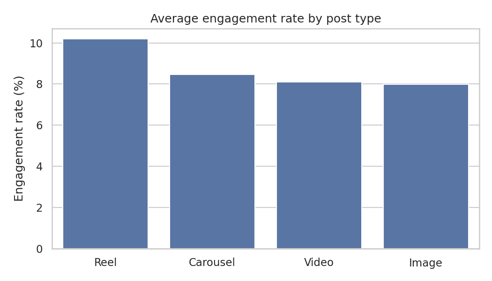
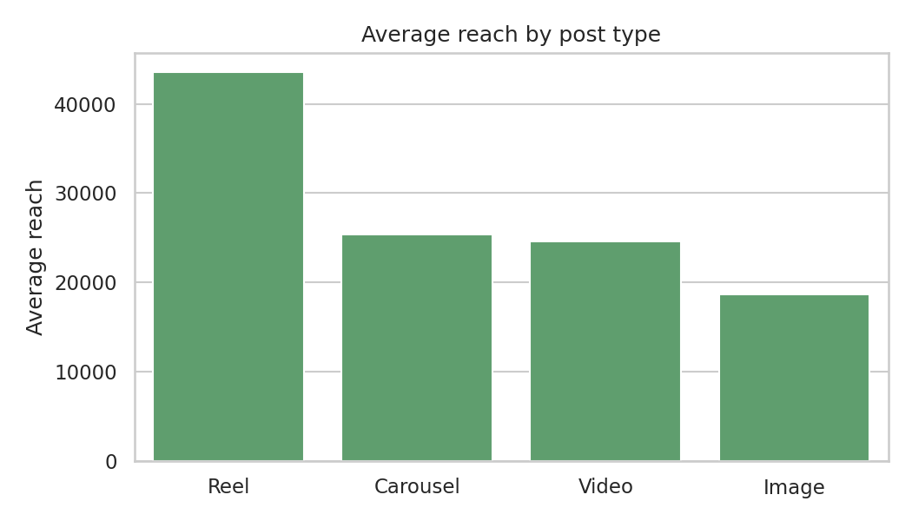
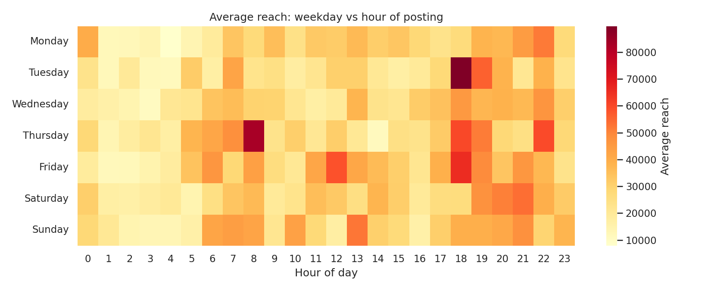
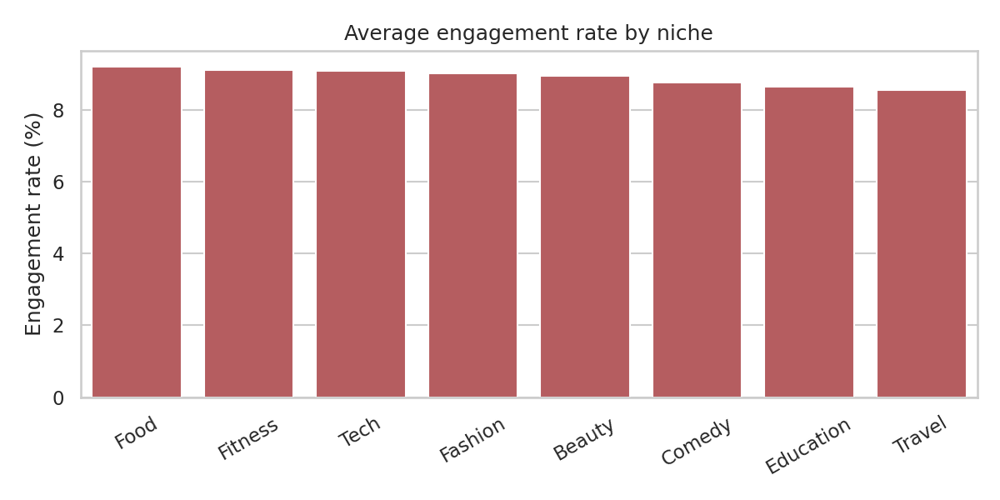
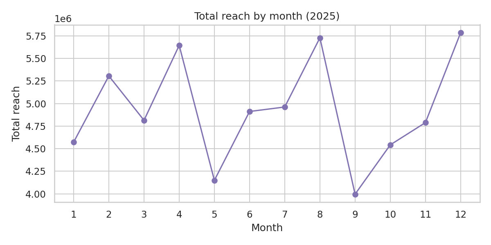
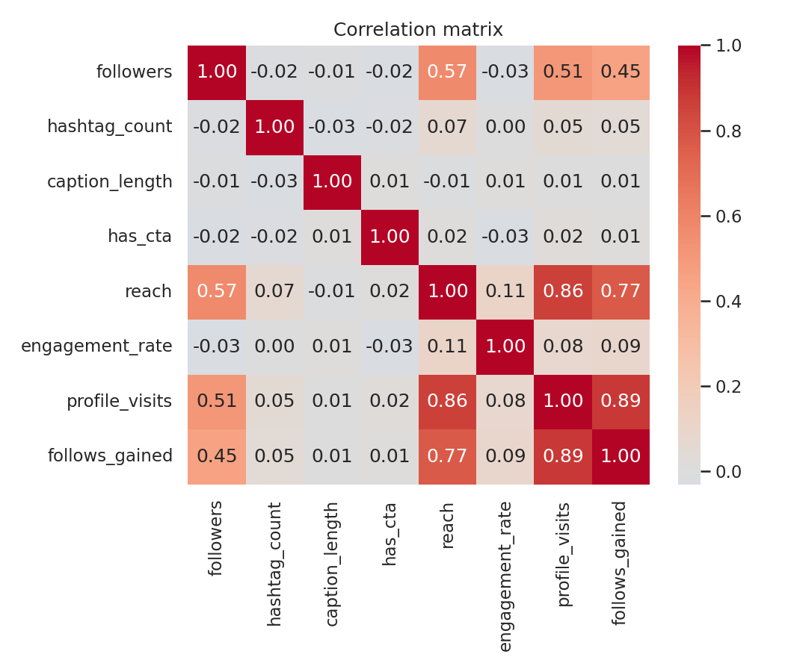

# Instagram Content Performance Analysis

An end-to-end data analyst project using **Excel, Python, SQL and Power BI** to find out which content choices drive reach and engagement on Instagram.

> **Data note:** Real Instagram data is not publicly available, so this project uses a **synthetic proxy dataset** (`data/instagram_raw.csv`): 2,000 posts from 60 accounts across 8 niches, covering 2025. It contains realistic patterns plus deliberate messiness (duplicates and missing values) for cleaning practice. **The findings below describe this simulated data and are not real-world conclusions.** The method is what transfers: swap in a real dataset (for example a Kaggle Instagram dataset or your own account's Insights export) and rerun everything.

## Business questions

1. Which post type gives the best engagement and reach?
2. What are the best times and days to post?
3. Do hashtags and calls-to-action (CTA) help?
4. Which niche performs best?

**Engagement rate** = (likes + comments + shares + saves) / reach

## Tools and what each was used for

| Tool | Used for | Files |
|---|---|---|
| **Excel** | Quick checks, formula-driven summary tables, weekday x hour heatmap, charts | `excel/instagram_analysis.xlsx` |
| **Python** (pandas, matplotlib, seaborn) | Cleaning, feature engineering, EDA, charts, correlation | `python/instagram_analysis.ipynb`, `python/analysis.py` |
| **SQL** | Two related tables (primary and foreign key), joins, CTEs, window functions | `sql/schema.sql`, `sql/queries.sql` |
| **Power BI** | Interactive dashboard | `powerbi/measures.dax`, `powerbi/dashboard_guide.md` |

## Project structure

```
instagram-analysis/
├── data/
│   ├── instagram_raw.csv        # raw synthetic data (2,015 rows incl. duplicates)
│   ├── instagram_clean.csv      # cleaned data (2,000 rows)
│   ├── accounts.csv             # accounts table (60 rows)
│   └── posts.csv                # posts table (2,000 rows)
├── excel/
│   ├── instagram_analysis.xlsx  # data + formula summary + charts
│   └── build_excel.py           # script that builds the workbook
├── python/
│   ├── instagram_analysis.ipynb # notebook with outputs
│   ├── analysis.py              # same analysis as a script, saves charts
│   └── make_notebook.py         # builds the notebook
├── sql/
│   ├── schema.sql               # CREATE TABLE with primary and foreign key
│   ├── queries.sql              # 11 analysis queries
│   ├── build_db.py              # splits data and loads SQLite
│   └── instagram.db             # ready-made SQLite database
├── powerbi/
│   ├── measures.dax             # DAX measures and calculated columns
│   └── dashboard_guide.md       # step-by-step dashboard build
├── images/                      # charts used in this README
├── requirements.txt
└── README.md
```

## Workflow

1. **Excel:** Open the data, remove duplicates, check blanks, build summary tables and a heatmap with `AVERAGEIF` and `AVERAGEIFS`, and chart the results.
2. **Python:** Remove 15 duplicate rows, fill 20 missing `saves` and 20 missing `caption_length` values with the median, create hour, weekday, time slot, hashtag group and engagement rate, then analyse and visualise.
3. **SQL:** Split the clean data into `accounts` (primary key `account_id`) and `posts` (foreign key `account_id`), then answer the same questions using `JOIN`, `GROUP BY`, `CASE`, CTEs, `RANK()` and `LAG()`.
4. **Power BI:** Load both tables, create the 1-to-many relationship, add DAX measures, and build the dashboard with slicers.

All four tools were checked against each other: Excel, SQL and Python give the same numbers (for example, Reel average reach is 43,576 in all three).

## Key insights

| # | Finding | Evidence |
|---|---|---|
| 1 | **Reels perform best** | Engagement rate 10.2% vs 8.0% for images; average reach 43,576 vs 18,607 (about 2.3x) |
| 2 | **Evenings are the best time to post** | Average reach 39,533 for 18:00-23:59 vs 18,179 for 00:00-05:59; 18:00 and 19:00 are the top hours |
| 3 | **Hashtags help up to about 15** | Average reach 24,403 (0-5 tags) rises to 31,170 (11-15 tags), then stays flat (31,061 for 16+) |
| 4 | **CTA makes little difference** | Reach is about 3% higher with a CTA (30,215 vs 29,191), but engagement rate is slightly lower (8.8% vs 8.9%) |
| 5 | **Niche affects reach more than engagement** | Comedy has the highest average reach (51,116) and Food the lowest (19,382), while engagement rates across niches stay between 8.5% and 9.2% |
| 6 | **Followers drive reach, not engagement rate** | Correlation of followers with reach is 0.57, but with engagement rate it is -0.03 |
| 7 | **Weekday matters less than hour** | Average reach by weekday ranges only from 27,349 (Wednesday) to 31,638 (Sunday) |

### Recommendations
- Make **Reels** the main content format.
- Post in the **evening (about 18:00-22:00)** and avoid 00:00-05:59.
- Use **around 10-15 hashtags**; more than 15 adds no extra reach.
- Don't expect a CTA alone to boost reach; test its effect on conversions instead.
- Judge accounts by **engagement rate**, not follower count.

## Charts








Add your Power BI screenshot here once built: ``

## How to run

```bash
pip install -r requirements.txt

python python/analysis.py        # cleans data, writes data/instagram_clean.csv and images/
python sql/build_db.py           # writes data/accounts.csv, data/posts.csv, sql/instagram.db
python excel/build_excel.py      # writes excel/instagram_analysis.xlsx
```

Run the SQL queries in `sql/queries.sql` with any SQLite tool (for example DB Browser for SQLite) on `sql/instagram.db`, or in MySQL/PostgreSQL after running `schema.sql` and importing the two CSV files.

For Power BI, follow `powerbi/dashboard_guide.md`.

## Limitations

- The data is synthetic, so effects such as "Reels are 2.3x better" reflect how the data was generated, not Instagram itself.
- Missing values were filled with the median, which is simple but ignores differences between accounts.
- `Avg Engagement Rate` averages the per-post rate (8.9%). Dividing total interactions by total reach gives a different, reach-weighted rate (9.2%). Both are valid, so state which one you use.
- The dataset has no real audience demographics, hashtag text or captions, so text analysis is not possible.

## Next steps

- Replace the proxy data with a real dataset and compare conclusions.
- Add a regression model predicting reach from post type, hour, hashtags and followers.
- Add NLP on captions and hashtags if real text data is available.
